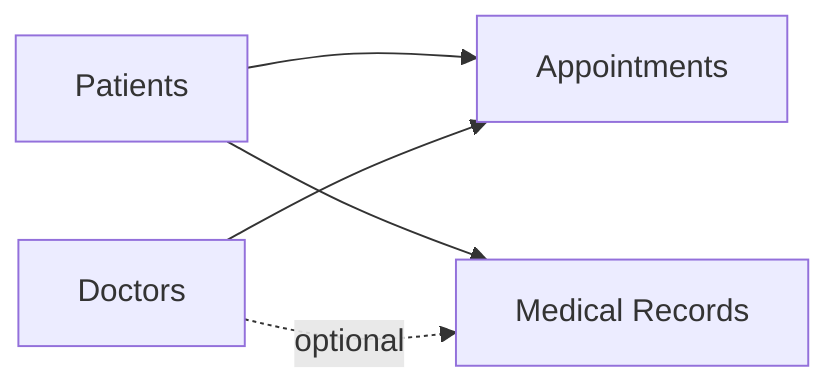

# MediCore — Hospital Management System

**MediCore** is a responsive, PHP-based hospital administration project built to demonstrate secure sign-in, relational database design, and CRUD workflows for patients, doctors, appointments, and medical records.

> **Educational portfolio project.** MediCore is a local development demonstration, **not** production-ready hospital software. Use fictional data only; do not store real patient or medical information.


## Overview

The application brings common hospital administration tasks into one workspace. An administrator can log in, see live dashboard statistics, and manage related records through a navy-and-blue interface designed for desktop and mobile screens.

### Main features

| Module | Features |
| --- | --- |
| **Admin authentication** | Username/password sign-in, password-hash verification, PHP sessions, logout, protected pages, and inactivity timeout |
| **Dashboard** | Live counts for patients, doctors, total appointments, and today's appointments; five recent appointments; quick navigation |
| **Patients** | Add, view, edit, and delete patients; address and contact details; search and gender filter |
| **Doctors** | Add, view, edit, and delete doctors; specialization and contact details; search and specialization filter |
| **Appointments** | Book appointments for existing patients/doctors; edit, cancel, and delete; date/status filters; checks for identical-time double bookings |
| **Medical records** | Create, view, edit, and delete records linked to patients and optionally doctors; diagnosis, treatment, notes, and dates; search/filtering |
| **Responsive interface** | Bootstrap 5 layouts, mobile-friendly navigation and tables, custom styling |


## 📸 Project Screenshots

### Dashboard
Real-time hospital statistics and recent appointments.


### Administrator Login
Secure administrator login interface.


### Patient Management
Add, view, edit, delete, and search patient records.


### Doctor Management
Manage doctor profiles and specializations.


### Appointment Management
Schedule and manage patient appointments.


### Medical Records Management
Manage patient medical records and clinical information.


### Mobile Responsive Design
MediCore interface optimized for smaller screens.


## Technology stack

- **Frontend:** HTML5, CSS3, Bootstrap 5, Bootstrap Icons, JavaScript where needed
- **Backend:** PHP 8.2 with PDO
- **Database:** MySQL / MariaDB (InnoDB tables and foreign keys)
- **Local environment:** XAMPP and phpMyAdmin
- **Development and version control:** VS Code, Git, GitHub Desktop

## Project structure

Application tree (`.git/` omitted; `config/database.local.php` is local and untracked):

```text
hospital-management-system/
├── app/
│   ├── modules/
│   │   ├── appointments/
│   │   │   ├── add_appointment.php
│   │   │   ├── appointment_common.php
│   │   │   ├── appointments.php
│   │   │   ├── delete_appointment.php
│   │   │   └── edit_appointment.php
│   │   ├── auth/
│   │   │   ├── login.php
│   │   │   └── logout.php
│   │   ├── dashboard/
│   │   │   └── dashboard.php
│   │   ├── doctors/
│   │   │   ├── add_doctor.php
│   │   │   ├── delete_doctor.php
│   │   │   ├── doctors.php
│   │   │   └── edit_doctor.php
│   │   ├── medical-records/
│   │   │   ├── add_medical_record.php
│   │   │   ├── delete_medical_record.php
│   │   │   ├── edit_medical_record.php
│   │   │   ├── medical_record_common.php
│   │   │   ├── medical_records.php
│   │   │   └── view_medical_record.php
│   │   └── patients/
│   │       ├── add_patient.php
│   │       ├── delete_patient.php
│   │       ├── edit_patient.php
│   │       └── patients.php
│   ├── shared/
│   │   ├── .htaccess
│   │   ├── auth_guard.php
│   │   ├── bootstrap.php
│   │   ├── directory_search.php
│   │   └── urls.php
│   ├── .htaccess
│   └── routes.php
├── config/
│   ├── .htaccess
│   └── database.local.php
├── database/
│   ├── .htaccess
│   └── hospital_management.sql
├── docs/
│   ├── screenshots/
│   │   ├── appointments.png
│   │   ├── dashboard.png
│   │   ├── doctors.png
│   │   ├── login.png
│   │   ├── medical-records.png
│   │   ├── mobile.png
│   │   └── patients.png
│   ├── LOCAL_SETUP.md
│   ├── SCREENSHOT_GUIDE.md
│   └── SECURITY_REVIEW.md
├── public/
│   ├── assets/
│   │   ├── css/
│   │   │   ├── login.css
│   │   │   ├── medicore-responsive.css
│   │   │   └── style.css
│   │   └── images/
│   │       └── hospital-banner.avif
│   ├── .htaccess
│   └── index.php
├── .gitattributes
├── .gitignore
├── .htaccess
└── README.md
```

The superseded root `assets/`, `includes/`, and `modules/` directories have been removed. There are no root PHP wrappers or duplicate PHP implementations; application code is under `app/`, and browser assets are under `public/assets/`.

### Application architecture

- `public/index.php` is the sole PHP web entry point. All 20 routes use a fixed allowlist in `app/routes.php`; request values never form PHP filenames.
- `app/shared/bootstrap.php` defines trusted paths and loads URL helpers without starting a session or connecting to MySQL. `urls.php` builds local route/asset URLs and redirects from the validated `MEDICORE_BASE_PATH` deployment setting, never the Host header.
- `app/shared/auth_guard.php` protects the dashboard and CRUD routes before database access, with the existing 30-minute timeout, security headers, and logout-token initialization. Login and logout retain their own session startup.
- `app/modules/` contains authentication, dashboard, and four CRUD modules. Common appointment/medical-record functions remain beside their pages. Module-local dependencies use `__DIR__`; shared/configuration paths use trusted root constants.
- PHP/PDO loads the unchanged private `config/database.local.php` connection only from handlers that need it. SQL, bindings, transactions, conflict rules, validation, CSRF tokens, deletion restrictions, and flash messages are retained.
- Local CSS and the banner are under `public/assets/`. There are no standalone JavaScript files. External Bootstrap, Bootstrap Icons, and font URLs remain unchanged.
- Root `.htaccess` blocks HTTP paths outside `public/`; `app/` and `app/shared/` also deny direct access. Existing `config/` and `database/` restrictions remain intact. This containment depends on Apache honoring the rules; it does not itself change the server document root.

### Routes

Use `http://127.0.0.1/hospital-management-system/public/index.php?route=ROUTE` during current XAMPP development. Omitting `route` selects the authenticated dashboard. All routes below are enabled.

| Route | Methods | Access |
| --- | --- | --- |
| `dashboard` | GET | Authenticated |
| `login` | GET, POST | Public/session-token validation |
| `logout` | POST | Public/session-token validation |
| `patients` | GET | Authenticated |
| `patients/create` | GET, POST | Authenticated |
| `patients/edit` | GET, POST | Authenticated |
| `patients/delete` | GET, POST | Authenticated |
| `doctors` | GET | Authenticated |
| `doctors/create` | GET, POST | Authenticated |
| `doctors/edit` | GET, POST | Authenticated |
| `doctors/delete` | GET, POST | Authenticated |
| `appointments` | GET | Authenticated |
| `appointments/create` | GET, POST | Authenticated |
| `appointments/edit` | GET, POST | Authenticated |
| `appointments/delete` | GET, POST | Authenticated |
| `medical-records` | GET | Authenticated |
| `medical-records/create` | GET, POST | Authenticated |
| `medical-records/view` | GET | Authenticated |
| `medical-records/edit` | GET, POST | Authenticated |
| `medical-records/delete` | GET, POST | Authenticated |

Edit/view/confirmation links retain `id`; edit POST actions retain it too. Delete POSTs keep their original body identifier and confirmation fields. Search forms keep hidden route selectors and their existing filters: patients `q/gender`, doctors `q/specialization`, appointments `q/status/date`, and medical records `q/from/to`.

Legacy URLs such as `patients.php` and `login.php` at the project root have been retired. They do not forward to old implementations. Use the front-controller routes.

See [Local Setup](docs/LOCAL_SETUP.md), [Screenshot Guide](docs/SCREENSHOT_GUIDE.md), and [Security Review](docs/SECURITY_REVIEW.md).

## Run locally

**Requirements:** PHP 8.2 with `pdo_mysql` and `mbstring`, a MySQL/MariaDB server, and Apache 2.4 with `mod_rewrite`, `mod_authz_core`, and the project's `.htaccess` protection enabled. The steps below use XAMPP on Windows. No Composer or npm installation is required by the current project.

1. Clone or download this repository into the XAMPP web root, e.g. `D:\Projects\xampp\htdocs\hospital-management-system`.
2. Start **Apache** and **MySQL** from XAMPP.
3. Open phpMyAdmin, create a database called `hospital_management`, and import `database/hospital_management.sql` (the schema-only export).
4. Create `config/database.local.php` with your own **local** PDO connection settings; do not commit this file. See [Local Setup](docs/LOCAL_SETUP.md) for a safe example.
5. Create an administrator account locally with a `password_hash()`-generated password hash. The repository intentionally provides **no default administrator credentials**. See [Local Setup](docs/LOCAL_SETUP.md).
6. Visit `http://127.0.0.1/hospital-management-system/public/index.php?route=login` and sign in.

The imported schema contains the five main application tables: `users`, `patients`, `doctors`, `appointments`, and `medical_records`. No demo patients or account credentials are bundled.

## Database relationships

- An **appointment** belongs to one patient and one doctor.
- A **medical record** belongs to a patient and can optionally reference a doctor.
- Foreign keys help maintain references between these tables.



## Security considerations

The demo includes password hashing/verification, PDO prepared statements, CSRF tokens for state-changing forms, HTML output escaping, authenticated page guards, inactivity timeout, and Apache access restrictions for sensitive folders.

**Known limitations:** Persistent login-attempt throttling has **not** been installed; administrator roles and fine-grained permissions, audit logging, encryption policies, and healthcare-specific retention controls are not implemented. Some demo CRUD operations permanently delete records. Same-time appointment conflict checks are implemented at application level and are not a substitute for database-level concurrency controls. The Apache public-only cutover remains a deployment step; see Local Setup for virtual-host and Alias options. Do not expose this project to the public internet or use real medical data without a substantial security and compliance review.

## Future improvements

- Role-based access control for distinct staff responsibilities
- Login-attempt throttling and stronger account recovery controls
- Audit logs and soft deletion/retention policies for sensitive records
- Pagination, reporting, automated tests, and database-level scheduling safeguards
- Deployment hardening, HTTPS, and secure backup management

## About this project

Built as an undergraduate software development portfolio project to practice PHP, relational SQL, secure form handling, full-stack workflows, and Git-based development.

## License

No open-source license has been selected yet. Until one is added, normal copyright rules apply. Choose a license deliberately before public release.
