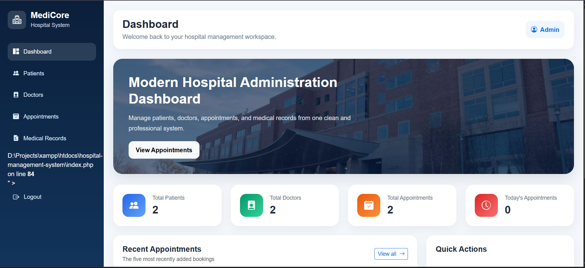
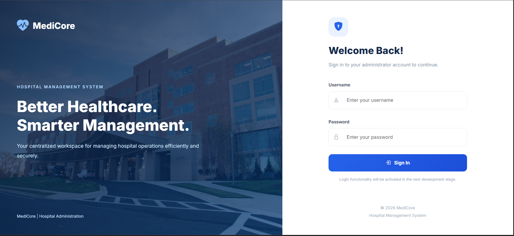
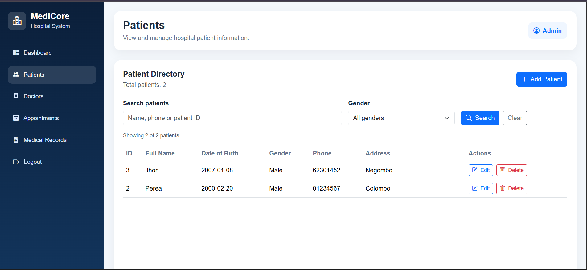
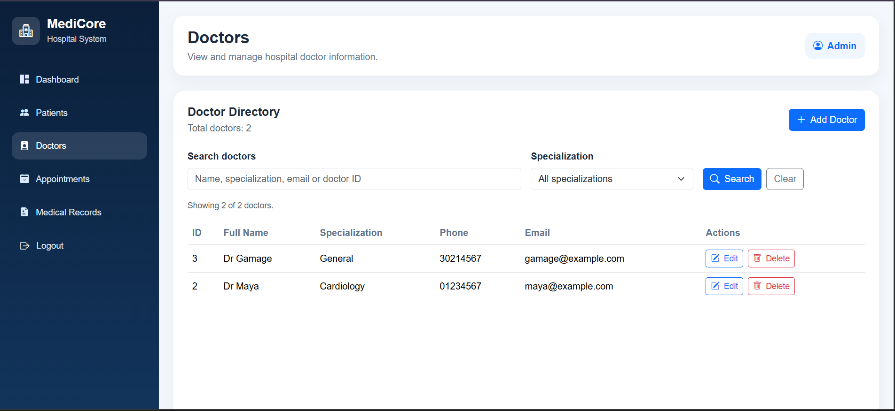
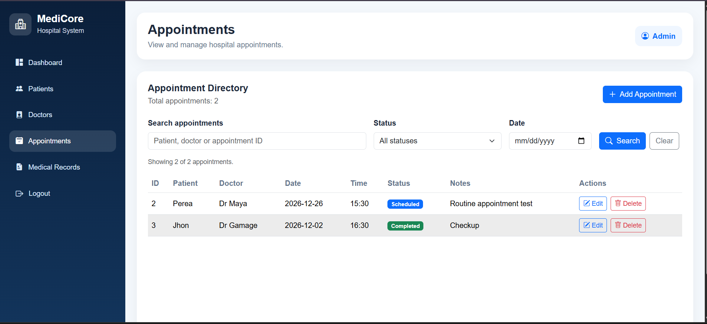
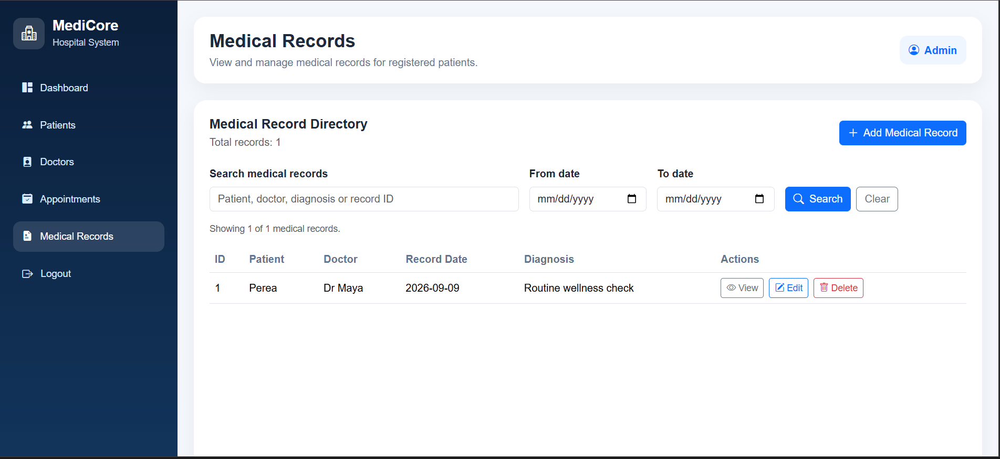
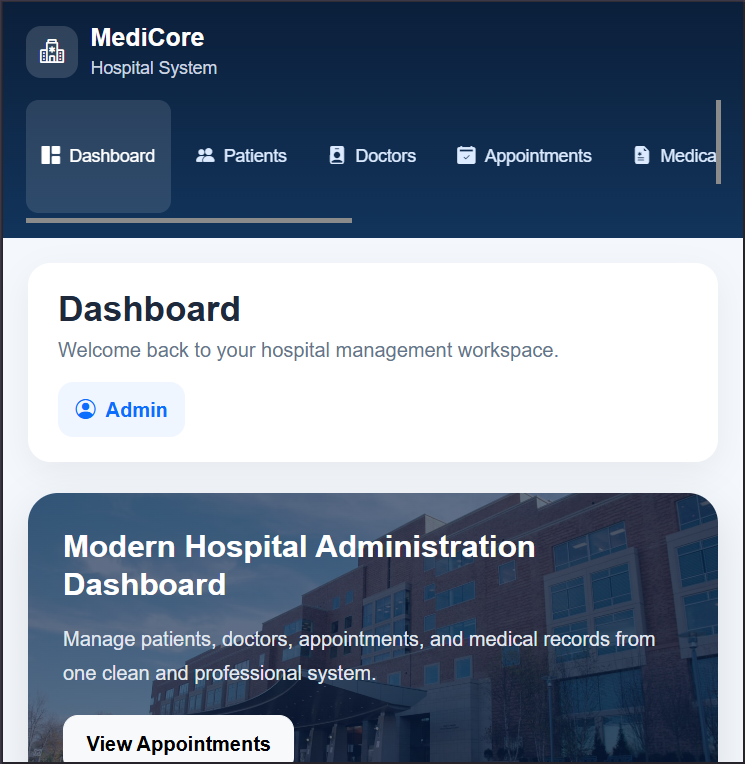
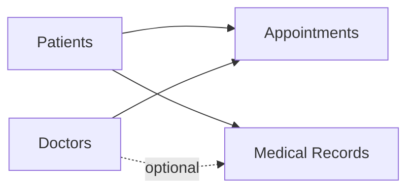

# MediCore — Hospital Management System

**MediCore** is a responsive, PHP-based hospital administration project built to demonstrate secure sign-in, relational database design, and CRUD workflows for patients, doctors, appointments, and medical records.

> **Educational portfolio project.** MediCore is a local development demonstration, **not** production-ready hospital software. Use fictional data only; do not store real patient or medical information.


## Overview

The application brings common hospital administration tasks into one workspace. An administrator can log in, see live dashboard statistics, and manage related records through a navy-and-blue interface designed for desktop and mobile screens.

### Main features

| Module | Features |
| --- | --- |
| **Admin authentication** | Username/password sign-in, password-hash verification, PHP sessions, logout, protected pages, and inactivity timeout |
| **Dashboard** | Live counts for patients, doctors, total appointments, and today's appointments; five recent appointments; quick navigation |
| **Patients** | Add, view, edit, and delete patients; address and contact details; search and gender filter |
| **Doctors** | Add, view, edit, and delete doctors; specialization and contact details; search and specialization filter |
| **Appointments** | Book appointments for existing patients/doctors; edit, cancel, and delete; date/status filters; checks for identical-time double bookings |
| **Medical records** | Create, view, edit, and delete records linked to patients and optionally doctors; diagnosis, treatment, notes, and dates; search/filtering |
| **Responsive interface** | Bootstrap 5 layouts, mobile-friendly navigation and tables, custom styling |


## 📸 Project Screenshots

### Dashboard
Real-time hospital statistics and recent appointments.



### Administrator Login
Secure administrator login interface.



### Patient Management
Add, view, edit, delete, and search patient records.



### Doctor Management
Manage doctor profiles and specializations.



### Appointment Management
Schedule and manage patient appointments.



### Medical Records Management
Manage patient medical records and clinical information.



### Mobile Responsive Design
MediCore interface optimized for smaller screens.




## Technology stack

- **Frontend:** HTML5, CSS3, Bootstrap 5, Bootstrap Icons, JavaScript where needed
- **Backend:** PHP 8.2 with PDO
- **Database:** MySQL / MariaDB (InnoDB tables and foreign keys)
- **Local environment:** XAMPP and phpMyAdmin
- **Development and version control:** VS Code, Git, GitHub Desktop

## Project structure

```text
hospital-management-system/
├── assets/
│   ├── css/
│   │   ├── style.css
│   │   ├── login.css
│   │   └── medicore-responsive.css
│   └── images/
├── config/
│   └── .htaccess
├── database/
│   ├── hospital_management.sql
│   └── .htaccess
├── docs/
│   ├── LOCAL_SETUP.md
│   ├── SCREENSHOT_GUIDE.md
│   └── screenshots/
├── auth_guard.php
├── directory_search.php
├── appointment_common.php
├── medical_record_common.php
├── index.php
├── login.php
├── logout.php
├── patients.php
├── doctors.php
├── appointments.php
├── medical_records.php
├── add_*.php
├── edit_*.php
├── delete_*.php
└── README.md
```

*Selected files shown. The `config/database.local.php` file is created locally and deliberately excluded from version control.*

## Run locally

**Requirements:** PHP 8.2 with `pdo_mysql`, a MySQL/MariaDB server, and a local PHP-capable web server. The steps below use XAMPP on Windows.

1. Clone or download this repository into the XAMPP web root, e.g. `D:\Projects\xampp\htdocs\hospital-management-system`.
2. Start **Apache** and **MySQL** from XAMPP.
3. Open phpMyAdmin, create a database called `hospital_management`, and import `database/hospital_management.sql` (the schema-only export).
4. Create `config/database.local.php` with your own **local** PDO connection settings; do not commit this file. See [Local Setup](docs/LOCAL_SETUP.md) for a safe example.
5. Create an administrator account locally with a `password_hash()`-generated password hash. The repository intentionally provides **no default administrator credentials**. See [Local Setup](docs/LOCAL_SETUP.md).
6. Visit `http://localhost/hospital-management-system/login.php` and sign in.

The imported schema contains the five main application tables: `users`, `patients`, `doctors`, `appointments`, and `medical_records`. No demo patients or account credentials are bundled.

## Database relationships

- An **appointment** belongs to one patient and one doctor.
- A **medical record** belongs to a patient and can optionally reference a doctor.
- Foreign keys help maintain references between these tables.



## Security considerations

The demo includes password hashing/verification, PDO prepared statements, CSRF tokens for state-changing forms, HTML output escaping, authenticated page guards, inactivity timeout, and Apache access restrictions for sensitive folders.

**Known limitations:** Persistent login-attempt throttling has **not** been installed; administrator roles and fine-grained permissions, audit logging, encryption policies, and healthcare-specific retention controls are not implemented. Some demo CRUD operations permanently delete records. Same-time appointment conflict checks are implemented at application level and are not a substitute for database-level concurrency controls. Do not expose this project to the public internet or use real medical data without a substantial security and compliance review.

## Future improvements

- Role-based access control for distinct staff responsibilities
- Login-attempt throttling and stronger account recovery controls
- Audit logs and soft deletion/retention policies for sensitive records
- Pagination, reporting, automated tests, and database-level scheduling safeguards
- Deployment hardening, HTTPS, and secure backup management

## About this project

Built as an undergraduate software development portfolio project to practice PHP, relational SQL, secure form handling, full-stack workflows, and Git-based development.

## License

No open-source license has been selected yet. Until one is added, normal copyright rules apply. Choose a license deliberately before public release.
